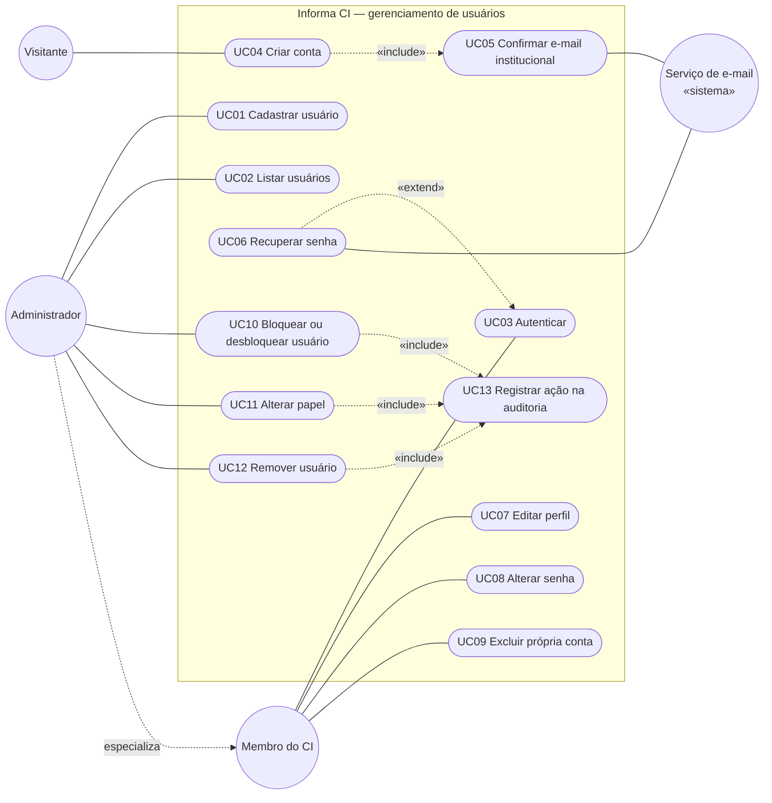

# Casos de uso

> Seção 6 do modelo. Os **requisitos** (RF) e seus **cenários de aceitação** estão em `openspec/specs/`.
> Aqui ficam o diagrama de casos de uso e, a partir da Entrega 2, a descrição detalhada dos 3 mais importantes.

## 6.1 Diagrama de casos de uso — gerenciamento de usuários

Nesta entrega o diagrama cobre o **gerenciamento de usuários**, núcleo essencial das Sprints 1 e 2. Os casos de uso dos módulos de Notícias e de Achados e Perdidos entram no diagrama completo da Entrega 2.

O diagrama usa Mermaid, que o GitHub desenha direto na página. A versão em UML formal (PlantUML) está em [`casos-de-uso.puml`](casos-de-uso.puml).

> O Administrador é um Membro do CI e herda os seus casos de uso. Os casos de uso do Membro e do Administrador pressupõem UC03 (Autenticar), omitido das ligações para não poluir o diagrama.

## Índice e rastreabilidade

| Caso de uso | Ator principal | Requisitos | Situação |
|---|---|---|---|
| UC01 Cadastrar usuário | Administrador | RF01, RF02, RF03, NF-SEG-01, NF-SEG-02, NF-CON-01, NF-MAN-01, NF-USA-01, NF-DES-01 | Implementado (Sprints 1 e 2) |
| UC02 Listar usuários | Administrador | RF04, NF-SEG-01, NF-CON-02, NF-MAN-01, NF-DES-01 | Implementado (Sprint 1) |
| UC03 Autenticar | Membro do CI | — | Visão §2.3; a especificar |
| UC04 Criar conta | Visitante | — | Visão §2.3; a especificar |
| UC05 Confirmar e-mail institucional | Visitante, Serviço de e-mail | — | Visão §2.3; a especificar |
| UC06 Recuperar senha | Membro do CI, Serviço de e-mail | — | Visão §2.3; a especificar |
| UC07 Editar perfil | Membro do CI | — | Visão §2.3; a especificar |
| UC08 Alterar senha | Membro do CI | — | Visão §2.3; a especificar |
| UC09 Excluir própria conta | Membro do CI | — | Visão §2.3; a especificar |
| UC10 Bloquear ou desbloquear usuário | Administrador | — | Visão §2.3; a especificar |
| UC11 Alterar papel | Administrador | — | Visão §2.3; a especificar |
| UC12 Remover usuário | Administrador | — | Visão §2.3; a especificar |
| UC13 Registrar ação na auditoria | Administrador | — | Visão §2.3; a especificar |

**Regra:** depois desta entrega, IDs de casos de uso **não** são renumerados nem reaproveitados.
