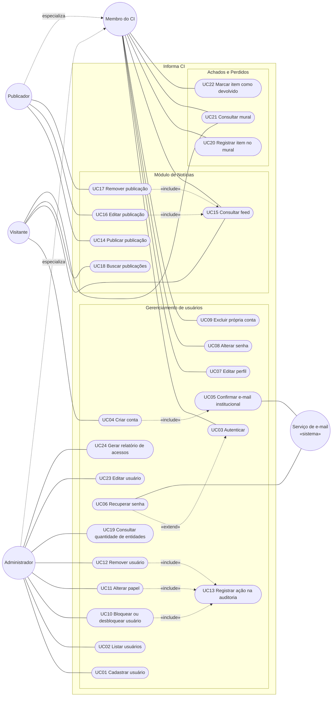

# Casos de uso

> Seção 6 do modelo. Os **requisitos** (RF) e seus **cenários de aceitação** estão em `openspec/specs/`.
> Aqui ficam o diagrama de casos de uso completo e a descrição detalhada dos 3 casos de uso mais relevantes.

## 6.1 Diagrama de casos de uso

O diagrama cobre todo o sistema: gerenciamento de usuários, Módulo de Notícias e Achados e Perdidos. Todos os requisitos funcionais definidos (RF01 a RF13) estão ligados a um caso de uso; a tabela de rastreabilidade abaixo mostra qual.

O diagrama usa Mermaid, que o GitHub desenha direto na página. A versão em UML formal (PlantUML) está em [`casos-de-uso.puml`](casos-de-uso.puml).

> Publicador e Administrador são Membros do CI e herdam os seus casos de uso. Os casos de uso do Membro, do Publicador e do Administrador pressupõem UC03 (Autenticar), omitido das ligações para não poluir o diagrama. Editar e remover incluem consultar o feed porque a publicação é escolhida pelo número com que aparece nele.

## 6.2 Casos de uso detalhados

Os 3 casos de uso mais relevantes, um do gerenciamento de usuários e dois da entidade principal (Publicação):

| Caso de uso | Por que foi escolhido |
|---|---|
| [UC01 Cadastrar usuário](UC01-cadastrar-usuario.md) | Porta de entrada do sistema; concentra as regras de login, senha e e-mail (RF01 a RF03) |
| [UC14 Publicar publicação](UC14-publicar-publicacao.md) | Objetivo central do sistema: reunir os avisos do CI num só lugar; envolve as duas entidades (Usuário como autor) |
| [UC16 Editar publicação](UC16-editar-publicacao.md) | Mantém as informações corretas (mudança de data, sala ou horário); base do "desfazer" da Sprint 5 |

## Índice e rastreabilidade

| Caso de uso | Ator principal | Requisitos | Situação |
|---|---|---|---|
| UC01 Cadastrar usuário | Administrador | RF01, RF02, RF03, NF-SEG-01, NF-SEG-02, NF-CON-01, NF-MAN-01, NF-USA-01, NF-DES-01 | Implementado (Sprints 1 a 3); [detalhado](UC01-cadastrar-usuario.md) |
| UC02 Listar usuários | Administrador | RF04, NF-SEG-01, NF-CON-02, NF-MAN-01, NF-DES-01 | Implementado (Sprint 1) |
| UC03 Autenticar | Membro do CI | — | Visão §2.3; a especificar |
| UC04 Criar conta | Visitante | — | Visão §2.3; a especificar |
| UC05 Confirmar e-mail institucional | Visitante, Serviço de e-mail | — | Visão §2.3; a especificar |
| UC06 Recuperar senha | Membro do CI, Serviço de e-mail | — | Visão §2.3; a especificar |
| UC07 Editar perfil | Membro do CI | — | Visão §2.3; a especificar |
| UC08 Alterar senha | Membro do CI | — | Visão §2.3; a especificar |
| UC09 Excluir própria conta | Membro do CI | — | Visão §2.3; a especificar |
| UC10 Bloquear ou desbloquear usuário | Administrador | — | Visão §2.3; a especificar |
| UC11 Alterar papel | Administrador | — | Visão §2.3; a especificar |
| UC12 Remover usuário | Administrador | RF11, NF-CON-01 | Implementado (Entrega 2), sem o registro na auditoria (UC13) |
| UC13 Registrar ação na auditoria | Administrador | — | Visão §2.3; a especificar |
| UC14 Publicar publicação | Publicador | RF05, NF-CON-01, NF-MAN-01 | Implementado (Sprint 3); [detalhado](UC14-publicar-publicacao.md) |
| UC15 Consultar feed | Visitante, Membro do CI | RF06 | Implementado (Sprint 3) |
| UC16 Editar publicação | Publicador | RF07, NF-CON-01 | Implementado (Sprint 3); [detalhado](UC16-editar-publicacao.md) |
| UC17 Remover publicação | Publicador | RF08, NF-CON-01 | Implementado (Sprint 3) |
| UC18 Buscar publicações | Visitante, Membro do CI | — | Visão §2.3; a especificar |
| UC19 Consultar quantidade de entidades | Administrador | RF09 | Implementado (Sprint 3) |
| UC20 Registrar item no mural | Membro do CI | — | Visão §2.3; a especificar |
| UC21 Consultar mural | Visitante, Membro do CI | — | Visão §2.3; a especificar |
| UC22 Marcar item como devolvido | Membro do CI | — | Visão §2.3; a especificar |
| UC23 Editar usuário | Administrador | RF10, NF-CON-01 | Implementado (Entrega 2) |
| UC24 Gerar relatório de acessos | Administrador | RF12, RF13 | Implementado (Sprint 4) |

**Regra:** IDs de casos de uso **não** são renumerados nem reaproveitados.
