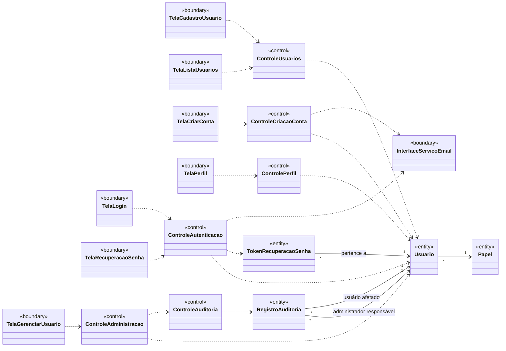

# Análise de casos de uso — diagrama de classes de análise

> Seção 7 do modelo. Classes **sem atributos e métodos**, mas com os relacionamentos já definidos.
> Estereótipos ICONIX: «boundary» (fronteira), «control» (controle), «entity» (entidade).
> Os nomes das entidades vêm do [glossário](02-glossario.md). Escopo desta entrega: gerenciamento de usuários (UC01 a UC13).

## Rastreabilidade caso de uso → classes

| Caso de uso | Controle | Fronteiras |
|---|---|---|
| UC01 Cadastrar usuário | ControleUsuarios | TelaCadastroUsuario |
| UC02 Listar usuários | ControleUsuarios | TelaListaUsuarios |
| UC03 Autenticar | ControleAutenticacao | TelaLogin |
| UC04 Criar conta | ControleCriacaoConta | TelaCriarConta |
| UC05 Confirmar e-mail institucional | ControleCriacaoConta | InterfaceServicoEmail |
| UC06 Recuperar senha | ControleAutenticacao | TelaRecuperacaoSenha, InterfaceServicoEmail |
| UC07 Editar perfil · UC08 Alterar senha · UC09 Excluir própria conta | ControlePerfil | TelaPerfil |
| UC10 Bloquear ou desbloquear · UC11 Alterar papel · UC12 Remover usuário | ControleAdministracao | TelaGerenciarUsuario |
| UC13 Registrar ação na auditoria | ControleAuditoria | — |

## Correspondência com o código atual

Nas Sprints 1 e 2 foram implementados UC01 e UC02. As classes de análise viraram estas classes de projeto (detalhes em [`08-projeto.md`](08-projeto.md)):

| Classe de análise | Classe no código |
|---|---|
| TelaCadastroUsuario, TelaListaUsuarios | `informaci.fronteira.TelaDeUsuarios` (uma tela de console com as duas opções) |
| ControleUsuarios | `informaci.controle.GerenciadorDeUsuarios` |
| Usuario | `informaci.entidade.Usuario` |
| Papel | `informaci.entidade.Papel` (enumeração: `MEMBRO`, `ADMINISTRADOR`) |
