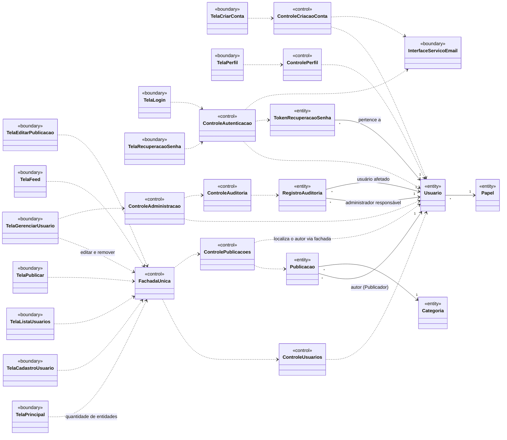

# Análise de casos de uso — diagrama de classes de análise

> Seção 7 do modelo. Classes **sem atributos e métodos**, mas com os relacionamentos já definidos.
> Estereótipos ICONIX: «boundary» (fronteira), «control» (controle), «entity» (entidade).
> Os nomes das entidades vêm do [glossário](02-glossario.md).

**Escopo (até a Sprint 3):** gerenciamento de usuários (UC01 a UC13) e Módulo de Notícias (UC14 a UC19), com o CRUD de duas entidades — **Usuário** e **Publicação** — atrás de uma **fachada única** (Facade + Singleton). Os casos de uso de Achados e Perdidos (UC20 a UC22) ainda não foram analisados.

## 7.1 Diagrama de classes de análise

**FachadaUnica** é o único controle com que as fronteiras implementadas conversam. Existe uma só instância (Singleton), e ela distribui cada pedido ao controle do caso de uso (Facade), combinando os dois quando a operação envolve as duas entidades: publicar em nome de um usuário e contar as entidades cadastradas. Os controles dos casos de uso ainda não implementados (autenticação, perfil, administração) passarão a ficar atrás da fachada quando forem implementados.

## 7.2 Rastreabilidade caso de uso → classes

| Caso de uso | Controle | Fronteiras |
|---|---|---|
| UC01 Cadastrar usuário | FachadaUnica → ControleUsuarios | TelaCadastroUsuario |
| UC02 Listar usuários | FachadaUnica → ControleUsuarios | TelaListaUsuarios |
| UC03 Autenticar | ControleAutenticacao | TelaLogin |
| UC04 Criar conta | ControleCriacaoConta | TelaCriarConta |
| UC05 Confirmar e-mail institucional | ControleCriacaoConta | InterfaceServicoEmail |
| UC06 Recuperar senha | ControleAutenticacao | TelaRecuperacaoSenha, InterfaceServicoEmail |
| UC07 Editar perfil · UC08 Alterar senha · UC09 Excluir própria conta | ControlePerfil | TelaPerfil |
| UC10 Bloquear ou desbloquear · UC11 Alterar papel | ControleAdministracao | TelaGerenciarUsuario |
| UC12 Remover usuário · UC23 Editar usuário | FachadaUnica → ControleUsuarios (e ControlePublicacoes, para conferir e atualizar o autor) | TelaGerenciarUsuario |
| UC13 Registrar ação na auditoria | ControleAuditoria | — |
| UC14 Publicar publicação | FachadaUnica → ControleUsuarios, ControlePublicacoes | TelaPublicar |
| UC15 Consultar feed | FachadaUnica → ControlePublicacoes | TelaFeed |
| UC16 Editar publicação | FachadaUnica → ControlePublicacoes | TelaFeed, TelaEditarPublicacao |
| UC17 Remover publicação | FachadaUnica → ControlePublicacoes | TelaFeed |
| UC19 Consultar quantidade de entidades | FachadaUnica → ControleUsuarios, ControlePublicacoes | TelaPrincipal |

## 7.3 Correspondência com o código atual

| Classe de análise | Classe no código |
|---|---|
| TelaPrincipal | `informaci.fronteira.TelaPrincipal` |
| TelaCadastroUsuario, TelaListaUsuarios, TelaGerenciarUsuario | `informaci.fronteira.TelaDeUsuarios` (uma tela de console com o CRUD) |
| TelaPublicar, TelaFeed, TelaEditarPublicacao | `informaci.fronteira.TelaDePublicacoes` (uma tela de console com o CRUD) |
| FachadaUnica | `informaci.controle.FacadeSingletonController` |
| ControleUsuarios | `informaci.controle.GerenciadorDeUsuarios` |
| ControlePublicacoes | `informaci.controle.GerenciadorDePublicacoes` |
| Usuario · Papel | `informaci.entidade.Usuario` · `Papel` (`MEMBRO`, `ADMINISTRADOR`, `PUBLICADOR`) |
| Publicacao · Categoria | `informaci.entidade.Publicacao` · `Categoria` (`NOTICIA`, `EVENTO`, `PALESTRA`, `COMUNICADO`) |
