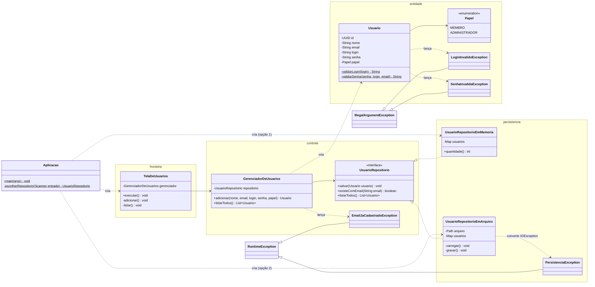

# Projeto detalhado — pacotes, classes de projeto e padrões

> Diferente do diagrama de **análise** ([`05-analise.md`](05-analise.md)), que é conceitual e muda pouco, o diagrama de classes de **projeto** reflete o código e é atualizado em toda sprint (ver [cronograma](00-entregas.md)).

## 1. Divisão de pacotes

```text
src/main/java/informaci/
├── Aplicacao.java         ← ponto de entrada: pergunta o armazenamento e monta as camadas
├── fronteira/             ← telas de console (TelaDeUsuarios)
├── controle/              ← casos de uso (GerenciadorDeUsuarios), contrato do repositório
│                            (UsuarioRepositorio) e exceções de regra de negócio
├── entidade/              ← Usuario, Papel e exceções de validação dos dados
└── persistencia/          ← implementações do repositório (memória e arquivo binário)
                             e PersistenciaException
src/test/java/informaci/   ← mesma estrutura; testes JUnit por cenário das specs
```

| Pacote do projeto | Camada sugerida pela disciplina |
|---|---|
| `fronteira` | `ui` |
| `controle`, `entidade` | `business` (`control`, `model`, `exception`) |
| `persistencia` | `infra` |

**Regra de dependência:** `fronteira` → `controle` → `entidade` ← `persistencia`. A interface `UsuarioRepositorio` foi declarada em `controle`, e não em `persistencia`: assim as regras de negócio não importam nenhuma classe de armazenamento, e é a persistência que depende delas (NF-MAN-01, [ADR-0001](07-arquitetura/adr/0001-persistencia-substituivel.md)). Só `Aplicacao` conhece todas as camadas, porque é ela que escolhe a implementação.

## 2. Diagrama de classes de projeto

### Estado atual: Sprints 1 e 2

Inclui as exceções de validação (S2.2) e os 2 mecanismos de persistência (S2.3).



**Tratamento das exceções** (`TelaDeUsuarios.adicionar`): cada exceção vira uma mensagem para o usuário, e o sistema continua em execução (NF-USA-01, NF-CON-01).

| Exceção | Lançada por | Mensagem exibida |
|---|---|---|
| `LoginInvalidoException` | `Usuario` (RF02) | "Login inválido: …" |
| `SenhaInvalidaException` | `Usuario` (RF03) | "Senha inválida: …" |
| `IllegalArgumentException` | `Usuario` (nome ou e-mail, RF01) | "Não foi possível adicionar: …" |
| `EmailJaCadastradoException` | `GerenciadorDeUsuarios` (RF01) | "Não foi possível adicionar: …" |
| `PersistenciaException` | `UsuarioRepositorioEmArquivo` | Ao gravar: "Falha ao armazenar o usuário: …". Ao ler, na inicialização: a mensagem é exibida e `Aplicacao` pergunta de novo o armazenamento |

## 3. Padrões de projeto utilizados

Preencha uma linha por padrão aplicado. Cada padrão relevante também tem um ADR.

| Padrão | Sprint | Classes participantes (papel no padrão) | Problema que resolve no projeto | ADR |
|---|---|---|---|---|
| Singleton | S3 | | | |
| Facade | S3 | | | |
| Repository | S4 | | | |
| Factory Method / Abstract Factory | S4 | | | |
| Adapter | S4 | | | |
| Template Method | S4 | | | |
| Command | S5 | | | |
| Memento | S5 | | | |

## 4. Rastreabilidade cenário → teste

Todo cenário de RF01 a RF04 é verificado por pelo menos um teste automatizado (NF-MAN-02).

| Requisito · cenário | Testes |
|---|---|
| RF01 · Cadastro válido | `GerenciadorDeUsuariosTest.deve_adicionar_usuario_quando_dados_sao_validos`, `TelaDeUsuariosTest.deve_adicionar_usuario_quando_dados_sao_validos` |
| RF01 · E-mail já cadastrado | `GerenciadorDeUsuariosTest.deve_rejeitar_email_duplicado_que_difere_apenas_por_maiusculas`, `nao_deve_persistir_usuario_quando_email_esta_duplicado`, `TelaDeUsuariosTest.deve_exibir_mensagem_quando_email_ja_esta_cadastrado` |
| RF01 · E-mail em formato inválido | `UsuarioTest.deve_rejeitar_quando_email_nao_tem_arroba`, `deve_rejeitar_quando_email_nao_tem_dominio` |
| RF01 · Nome vazio | `UsuarioTest.deve_rejeitar_quando_nome_esta_em_branco` |
| RF02 · Login vazio | `UsuarioTest.deve_rejeitar_quando_login_esta_vazio`, `deve_rejeitar_quando_login_esta_em_branco` |
| RF02 · Login com mais de 12 caracteres | `UsuarioTest.deve_rejeitar_quando_login_tem_mais_de_12_caracteres` |
| RF02 · Login com exatamente 12 caracteres | `UsuarioTest.deve_aceitar_login_com_exatamente_12_caracteres` |
| RF02 · Login com números | `UsuarioTest.deve_rejeitar_quando_login_tem_numeros`, `TelaDeUsuariosTest.deve_exibir_mensagem_quando_login_e_invalido` |
| RF03 · Senha vazia | `UsuarioTest.deve_rejeitar_quando_senha_esta_vazia` |
| RF03 · Senha curta | `UsuarioTest.deve_rejeitar_quando_senha_tem_menos_de_8_caracteres` |
| RF03 · Senha longa | `UsuarioTest.deve_rejeitar_quando_senha_tem_mais_de_128_caracteres` |
| RF03 · Senha com poucos tipos de caractere | `UsuarioTest.deve_rejeitar_quando_senha_tem_apenas_um_tipo_de_caractere`, `deve_rejeitar_quando_senha_tem_apenas_dois_tipos_de_caractere` |
| RF03 · Senha com três tipos de caractere | `UsuarioTest.deve_aceitar_senha_com_tres_tipos_de_caractere` |
| RF03 · Senha igual ao login | `UsuarioTest.deve_rejeitar_quando_senha_e_igual_ao_login` |
| RF03 · Senha igual ao e-mail | `UsuarioTest.deve_rejeitar_quando_senha_e_igual_ao_email` |
| RF04 · Listagem com usuários | `GerenciadorDeUsuariosTest.deve_listar_todos_os_usuarios_cadastrados`, `TelaDeUsuariosTest.deve_listar_os_usuarios_cadastrados` |
| RF04 · Nenhum usuário | `TelaDeUsuariosTest.deve_informar_quando_nao_ha_usuarios_cadastrados` |
| NF-SEG-01 · Senha nunca exibida | `UsuarioTest.nao_deve_expor_a_senha_na_representacao_textual` |
| NF-CON-01 · Falha de armazenamento | `UsuarioRepositorioEmArquivoTest.deve_lancar_persistencia_exception_quando_nao_consegue_gravar`, `deve_lancar_persistencia_exception_quando_arquivo_esta_corrompido` |
| NF-CON-02 · Dados preservados | `UsuarioRepositorioEmArquivoTest.deve_manter_os_usuarios_apos_reabrir_o_repositorio` |
