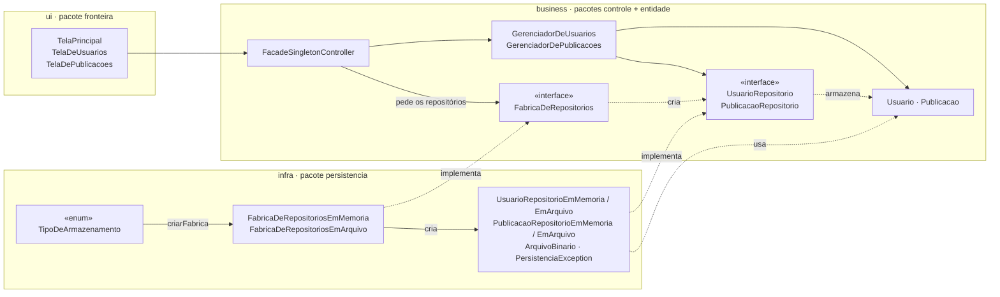

# Projeto detalhado — pacotes, classes de projeto e padrões

> Diferente do diagrama de **análise** ([`05-analise.md`](05-analise.md)), que é conceitual e muda pouco, o diagrama de classes de **projeto** reflete o código e é atualizado em toda sprint (ver [cronograma](00-entregas.md)).

## 1. Divisão de pacotes

```text
src/main/java/informaci/
├── Aplicacao.java         ← ponto de entrada: pergunta o armazenamento (TipoDeArmazenamento),
│                            obtém a fábrica de repositórios e inicializa a fachada com ela
├── fronteira/             ← telas de console (TelaPrincipal, TelaDeUsuarios, TelaDePublicacoes)
├── controle/              ← fachada única (FacadeSingletonController), gerentes dos casos de uso
│                            (GerenciadorDeUsuarios, GerenciadorDePublicacoes), contratos dos
│                            repositórios e da fábrica abstrata (FabricaDeRepositorios) e
│                            exceções de regra de negócio
├── entidade/              ← Usuario, Papel, Publicacao, Categoria, DadosDaPublicacao,
│                            validadores (nome, e-mail, login, senha) e exceções de validação
├── log/                   ← JulLogAdapter: adapta java.util.logging ao ServicoDeLog do controle
│                            (infra; padrão Adapter, ADR-0004)
└── persistencia/          ← implementações dos repositórios (memória e arquivo binário), fábricas
                             concretas (FabricaDeRepositoriosEmMemoria/EmArquivo),
                             TipoDeArmazenamento, ArquivoBinario e PersistenciaException
src/test/java/informaci/   ← mesma estrutura; testes JUnit por cenário das specs
```

| Pacote do projeto | Camada sugerida pela disciplina |
|---|---|
| `fronteira` | `ui` |
| `controle`, `entidade` | `business` (`control`, `model`, `exception`) |
| `persistencia` | `infra` |

**Regra de dependência:** `fronteira` → `controle` → `entidade` ← `persistencia`. As interfaces `UsuarioRepositorio` e `PublicacaoRepositorio` foram declaradas em `controle`, e não em `persistencia`: assim as regras de negócio não importam nenhuma classe de armazenamento, e é a persistência que depende delas (NF-MAN-01, [ADR-0001](07-arquitetura/adr/0001-persistencia-substituivel.md)). A fronteira conversa apenas com a `FacadeSingletonController` ([ADR-0002](07-arquitetura/adr/0002-fachada-unica.md)). Só `Aplicacao` conhece todas as camadas, porque é ela que escolhe o tipo de armazenamento; quem cria os repositórios concretos são as fábricas ([ADR-0003](07-arquitetura/adr/0003-repository-e-fabrica-de-repositorios.md)).

## 2. Diagrama de classes de projeto

### Estado atual: Sprint 4 — camadas business e infra separadas (S4.1)

Refaz o diagrama da Sprint 3 agrupando as classes nas camadas da disciplina (`ui`, `business`, `infra`) e tornando explícita a comunicação entre **business** e **infra** para as duas entidades do projeto, `Usuario` e `Publicacao`.

**Visão por camadas**



**Como as camadas se comunicam**

| Entidade | Business (usa) | Contrato entre as camadas | Infra (implementa) |
|---|---|---|---|
| `Usuario` | `GerenciadorDeUsuarios` | `UsuarioRepositorio` | `UsuarioRepositorioEmMemoria`, `UsuarioRepositorioEmArquivo` |
| `Publicacao` | `GerenciadorDePublicacoes` | `PublicacaoRepositorio` | `PublicacaoRepositorioEmMemoria`, `PublicacaoRepositorioEmArquivo` |

- **business → infra:** nenhuma classe de `business` referencia uma classe de `infra`. Os gerentes só enxergam a interface do repositório (que pertence a `business.controle`).
- **infra → business:** `infra` implementa as interfaces e manipula as entidades (`Usuario`, `Publicacao`); é a única direção de dependência entre as camadas (inversão de dependência, [ADR-0001](07-arquitetura/adr/0001-persistencia-substituivel.md)).
- **Detalhes de armazenamento** (`ArquivoBinario`, `IOException`, `PersistenciaException`) ficam inteiramente em `infra`; `business` não precisa conhecê-los.
- **Criação dos repositórios (Abstract Factory + Factory Method):** a fachada recebe uma `FabricaDeRepositorios` (interface de `business.controle`) e pede a ela o repositório de cada entidade. As fábricas concretas ficam em `infra`, uma por família de armazenamento, e são escolhidas pelo Factory Method `TipoDeArmazenamento.criarFabrica`.
- **`Aplicacao`** é a raiz de composição: o único ponto que conhece as três camadas. Ela só escolhe o `TipoDeArmazenamento` e entrega à fachada a fábrica correspondente, sem instanciar nenhum repositório concreto.

**Diagrama de classes**

```mermaid
classDiagram
    direction TB

    class Aplicacao {
        <<composition root>>
        +main(args)$ void
        -inicializarFachada(Scanner entrada)$ FacadeSingletonController
        -escolherArmazenamento(Scanner entrada)$ TipoDeArmazenamento
    }

    namespace ui.fronteira {
        class TelaPrincipal {
            +executar() void
            -exibirQuantidade() void
        }
        class TelaDeUsuarios {
            +executar() void
            -adicionar() void
            -listar() void
        }
        class TelaDePublicacoes {
            +executar() void
            -publicar() void
            -exibirFeed() void
            -editar() void
            -remover() void
        }
        class Console {
            ~ler(String rotulo) String
            ~escrever(String linha) void
        }
    }

    namespace business.controle {
        class FacadeSingletonController {
            <<Singleton, Facade>>
            -FacadeSingletonController instancia$
            -GerenciadorDeUsuarios usuarios
            -GerenciadorDePublicacoes publicacoes
            +inicializar(FabricaDeRepositorios fabrica, ServicoDeLog log, RegistroDeAcessoRepositorio repoAcessos)$ FacadeSingletonController
            +inicializar(FabricaDeRepositorios fabrica)$ FacadeSingletonController
            ~inicializar(UsuarioRepositorio, PublicacaoRepositorio)$ FacadeSingletonController
            +getInstancia()$ FacadeSingletonController
            +encerrar()$ void
            +adicionarUsuario(nome, email, login, senha, papel) Usuario
            +listarUsuarios() List~Usuario~
            +editarUsuario(UUID id, DadosDoUsuario dados) Usuario
            +removerUsuario(UUID id) void
            +publicar(String emailDoAutor, DadosDaPublicacao dados) Publicacao
            +listarFeed() List~Publicacao~
            +editarPublicacao(UUID id, DadosDaPublicacao dados) Publicacao
            +removerPublicacao(UUID id) void
            +quantidadeDeUsuarios() int
            +quantidadeDePublicacoes() int
            +quantidadeDeEntidadesCadastradas() int
            +gerarRelatorioDeAcessos()
        }
        class GerenciadorDeUsuarios {
            -UsuarioRepositorio repositorio
            +adicionar(nome, email, login, senha, papel) Usuario
            +listarTodos() List~Usuario~
            +buscarPorEmail(String email) Usuario
            +buscarPorId(UUID id) Usuario
            +editar(UUID id, DadosDoUsuario dados) Usuario
            +remover(UUID id) void
            +quantidade() int
        }
        class GerenciadorDePublicacoes {
            -PublicacaoRepositorio repositorio
            +publicar(Usuario autor, DadosDaPublicacao dados) Publicacao
            +listarFeed() List~Publicacao~
            +buscarPorId(UUID id) Publicacao
            +editar(UUID id, DadosDaPublicacao dados) Publicacao
            +remover(UUID id) void
            +contarDoAutor(Usuario autor) int
            +atualizarAutor(Usuario autor) void
            +quantidade() int
        }
        class UsuarioRepositorio {
            <<interface · porta da persistência>>
            +salvar(Usuario usuario) void
            +buscarPorId(UUID id) Optional~Usuario~
            +buscarPorEmail(String email) Optional~Usuario~
            +existeComEmail(String email) boolean
            +listarTodos() List~Usuario~
            +remover(UUID id) void
        }
        class PublicacaoRepositorio {
            <<interface · porta da persistência>>
            +salvar(Publicacao publicacao) void
            +buscarPorId(UUID id) Optional~Publicacao~
            +listarTodas() List~Publicacao~
            +remover(UUID id) void
        }
        class FabricaDeRepositorios {
            <<interface · Abstract Factory>>
            +criarRepositorioDeUsuarios() UsuarioRepositorio
            +criarRepositorioDePublicacoes() PublicacaoRepositorio
        }
        class ServicoDeLog {
            <<interface · Adapter: Target>>
            +info(String mensagem) void
            +aviso(String mensagem) void
            +erro(String mensagem, Throwable causa) void
        }
        class NullLog {
            <<Null Object>>
        }
        class EmailJaCadastradoException
        class UsuarioNaoEncontradoException
        class UsuarioComPublicacoesException
        class PublicacaoNaoEncontradaException
    }

    namespace business.entidade {
        class Usuario {
            <<Serializable>>
            -UUID id
            -String nome
            -String email
            -String login
            -String senha
            -Papel papel
            +comDados(DadosDoUsuario novosDados) Usuario
        }
        class DadosDoUsuario {
            <<record>>
            nome
            email
            login
            senha
            papel
        }
        class Papel {
            <<enumeration>>
            MEMBRO
            ADMINISTRADOR
            PUBLICADOR
        }
        class Publicacao {
            <<Serializable>>
            -UUID id
            -Usuario autor
            -LocalDateTime dataDePublicacao
            -String titulo
            -String texto
            -Categoria categoria
            -LocalDateTime dataHora
            -String local
            +comDados(DadosDaPublicacao novosDados) Publicacao
            +comAutor(Usuario autor) Publicacao
        }
        class DadosDaPublicacao {
            <<record>>
            titulo
            texto
            categoria
            dataHora
            local
        }
        class Categoria {
            <<enumeration>>
            NOTICIA
            EVENTO
            PALESTRA
            COMUNICADO
            +exigeDataELocal() boolean
        }
        class ValidadorDeNome {
            +validar(String nome)$ String
        }
        class ValidadorDeEmail {
            +validar(String email)$ String
            +normalizar(String email)$ String
        }
        class ValidadorDeLogin {
            +validar(String login)$ String
        }
        class ValidadorDeSenha {
            +validar(String senha, String login, String email)$ String
        }
        class NomeInvalidoException
        class EmailInvalidoException
        class LoginInvalidoException
        class SenhaInvalidaException
        class PublicacaoInvalidaException
    }

    namespace infra.log {
        class JulLogAdapter {
            <<Adapter>>
            -Logger logger
            +gravandoEm(String nome, Path arquivo)$ JulLogAdapter
        }
        class Logger {
            <<java.util.logging · Adaptee>>
        }
    }

    namespace infra.persistencia {
        class UsuarioRepositorioEmMemoria
        class UsuarioRepositorioEmArquivo {
            -Path arquivo
        }
        class PublicacaoRepositorioEmMemoria
        class PublicacaoRepositorioEmArquivo {
            -Path arquivo
        }
        class ArquivoBinario {
            ~ler(Path arquivo, Class tipo)$ List
            ~gravar(Path arquivo, List objetos)$ void
        }
        class PersistenciaException
        class FabricaDeRepositoriosEmMemoria {
            +criarRepositorioDeUsuarios() UsuarioRepositorio
            +criarRepositorioDePublicacoes() PublicacaoRepositorio
        }
        class FabricaDeRepositoriosEmArquivo {
            -Path pasta
            +criarRepositorioDeUsuarios() UsuarioRepositorio
            +criarRepositorioDePublicacoes() PublicacaoRepositorio
        }
        class TipoDeArmazenamento {
            <<enumeration · Factory Method>>
            MEMORIA
            ARQUIVO
            +descricao(Path pasta) String
            +criarFabrica(Path pasta) FabricaDeRepositorios
        }
    }

    %% ── ui → business (somente pela fachada) ──
    TelaPrincipal --> TelaDeUsuarios
    TelaPrincipal --> TelaDePublicacoes
    TelaPrincipal --> FacadeSingletonController
    TelaDeUsuarios --> FacadeSingletonController
    TelaDePublicacoes --> FacadeSingletonController
    TelaDeUsuarios --> Console
    TelaDePublicacoes --> Console

    %% ── dentro de business ──
    GerenciadorDeUsuarios --> ServicoDeLog : registra eventos
    GerenciadorDePublicacoes --> ServicoDeLog : registra eventos
    ServicoDeLog <|.. NullLog
    FacadeSingletonController *-- GerenciadorDeUsuarios
    FacadeSingletonController *-- GerenciadorDePublicacoes
    GerenciadorDeUsuarios ..> Usuario : cria
    GerenciadorDePublicacoes ..> Publicacao : cria
    Usuario --> Papel
    Publicacao "*" --> "1" Usuario : autor
    Publicacao --> Categoria
    Usuario ..> DadosDoUsuario : valida
    Publicacao ..> DadosDaPublicacao : valida
    Usuario ..> ValidadorDeNome
    Usuario ..> ValidadorDeEmail
    Usuario ..> ValidadorDeLogin
    Usuario ..> ValidadorDeSenha
    GerenciadorDeUsuarios ..> ValidadorDeEmail : normalizar
    ValidadorDeNome ..> NomeInvalidoException : lança
    ValidadorDeEmail ..> EmailInvalidoException : lança
    ValidadorDeLogin ..> LoginInvalidoException : lança
    ValidadorDeSenha ..> SenhaInvalidaException : lança
    Publicacao ..> PublicacaoInvalidaException : lança
    GerenciadorDeUsuarios ..> EmailJaCadastradoException : lança
    GerenciadorDeUsuarios ..> UsuarioNaoEncontradoException : lança
    GerenciadorDePublicacoes ..> PublicacaoNaoEncontradaException : lança
    FacadeSingletonController ..> UsuarioComPublicacoesException : lança

    %% ── business → infra: SOMENTE através das interfaces (porta) ──
    GerenciadorDeUsuarios --> UsuarioRepositorio : usa
    GerenciadorDePublicacoes --> PublicacaoRepositorio : usa
    UsuarioRepositorio ..> Usuario : armazena
    PublicacaoRepositorio ..> Publicacao : armazena

    %% ── infra → business: implementa as portas (inversão de dependência) ──
    UsuarioRepositorio <|.. UsuarioRepositorioEmMemoria
    UsuarioRepositorio <|.. UsuarioRepositorioEmArquivo
    PublicacaoRepositorio <|.. PublicacaoRepositorioEmMemoria
    PublicacaoRepositorio <|.. PublicacaoRepositorioEmArquivo
    UsuarioRepositorioEmArquivo ..> ArquivoBinario
    PublicacaoRepositorioEmArquivo ..> ArquivoBinario
    UsuarioRepositorioEmArquivo ..> PersistenciaException : converte IOException
    PublicacaoRepositorioEmArquivo ..> PersistenciaException : converte IOException

    %% ── criação dos repositórios: Abstract Factory + Factory Method ──
    FacadeSingletonController ..> FabricaDeRepositorios : pede os repositórios
    FabricaDeRepositorios <|.. FabricaDeRepositoriosEmMemoria
    FabricaDeRepositorios <|.. FabricaDeRepositoriosEmArquivo
    FabricaDeRepositoriosEmMemoria ..> UsuarioRepositorioEmMemoria : cria
    FabricaDeRepositoriosEmMemoria ..> PublicacaoRepositorioEmMemoria : cria
    FabricaDeRepositoriosEmArquivo ..> UsuarioRepositorioEmArquivo : cria
    FabricaDeRepositoriosEmArquivo ..> PublicacaoRepositorioEmArquivo : cria
    TipoDeArmazenamento ..> FabricaDeRepositoriosEmMemoria : MEMORIA cria
    TipoDeArmazenamento ..> FabricaDeRepositoriosEmArquivo : ARQUIVO cria

    %% ── composition root: único ponto que conhece as três camadas ──
    Aplicacao ..> TelaPrincipal : cria
    Aplicacao ..> TipoDeArmazenamento : escolhe
    Aplicacao ..> FacadeSingletonController : inicializa com a fábrica e o log
    Aplicacao ..> JulLogAdapter : cria (gravando em informaci.log)

    %% ── Adapter: infra adapta a biblioteca de log ao contrato de business ──
    ServicoDeLog <|.. JulLogAdapter : Adapter
    JulLogAdapter --> Logger : adapta

   %% ---------------------------------------------------
    %% CLASSES DO ITEM 4 E TEMPLATE METHOD CORRIGIDO
    %% ---------------------------------------------------
    namespace business.entidade {
        class TipoDeOperacao {
            <<enumeration>>
        }
        class FormatoDeRelatorio {
            <<enumeration>>
        }
        class RegistroDeAcesso {
            <<entity>>
        }
        class EstatisticasDeAcesso {
            <<entity>>
        }
    }

    namespace business.controle {
        class GerenciadorDeAcessos
        class RegistroDeAcessoRepositorio {
            <<interface>>
        }
        
        note for GeradorDeRelatorioDeAcessos "Padrão: Template Method"
        class GeradorDeRelatorioDeAcessos {
            <<template>>
            +gerar(EstatisticasDeAcesso) byte[]
            +extensao()* String
            #iniciarDocumento(String)*
            #escreverParagrafo(String)*
            #escreverTabela(String, List, List)*
            #concluirDocumento()* byte[]
        }
        class RelatorioDeAcessosEmHtml {
            +extensao() String
            #iniciarDocumento(String)
            #escreverParagrafo(String)
            #escreverTabela(String, List, List)
            #concluirDocumento() byte[]
        }
        class RelatorioDeAcessosEmPdf {
            +extensao() String
            #iniciarDocumento(String)
            #escreverParagrafo(String)
            #escreverTabela(String, List, List)
            #concluirDocumento() byte[]
        }
    }

    namespace infra {
        class RegistroDeAcessoRepositorioEmMemoria {
            <<repository>>
        }
        class RegistroDeAcessoRepositorioEmArquivo {
            <<repository>>
        }
    }

    GeradorDeRelatorioDeAcessos <|-- RelatorioDeAcessosEmHtml : especializa
    GeradorDeRelatorioDeAcessos <|-- RelatorioDeAcessosEmPdf : especializa
    RegistroDeAcessoRepositorio <|.. RegistroDeAcessoRepositorioEmMemoria : implementa
    RegistroDeAcessoRepositorio <|.. RegistroDeAcessoRepositorioEmArquivo : implementa
```



> Para não poluir o diagrama, as superclasses das exceções foram omitidas: `NomeInvalidoException`, `EmailInvalidoException`, `LoginInvalidoException`, `SenhaInvalidaException` e `PublicacaoInvalidaException` estendem `IllegalArgumentException`; as demais estendem `RuntimeException`.

**Tratamento das exceções** (`TelaDeUsuarios` e `TelaDePublicacoes`): cada exceção vira uma mensagem para o usuário, e o sistema continua em execução (NF-USA-01, NF-CON-01).

| Exceção | Lançada por | Mensagem exibida |
|---|---|---|
| `NomeInvalidoException` | `ValidadorDeNome` (RF01) | "Não foi possível adicionar: …" |
| `EmailInvalidoException` | `ValidadorDeEmail` (RF01) | "Não foi possível adicionar: …" |
| `LoginInvalidoException` | `ValidadorDeLogin` (RF02) | "Login inválido: …" |
| `SenhaInvalidaException` | `ValidadorDeSenha` (RF03) | "Senha inválida: …" |
| `EmailJaCadastradoException` | `GerenciadorDeUsuarios` (RF01) | "Não foi possível adicionar: …" |
| `PublicacaoInvalidaException` | `Publicacao` | "Publicação inválida: …" |
| `UsuarioNaoEncontradoException` | `GerenciadorDeUsuarios` (autor da publicação) | "Não foi possível publicar: …" |
| `UsuarioComPublicacoesException` | `FacadeSingletonController` (RF11) | "Não foi possível remover: …" |
| `PublicacaoNaoEncontradaException` | `GerenciadorDePublicacoes` | "Não foi possível editar: …" / "Não foi possível remover: …" |
| `PersistenciaException` | repositórios em arquivo | Ao gravar: "Falha ao armazenar …". Ao ler, na inicialização: a mensagem é exibida e `Aplicacao` pergunta de novo o armazenamento. Se a gravação falhar, a cópia em memória volta ao estado anterior |

## 3. Padrões de projeto utilizados

Preencha uma linha por padrão aplicado. Cada padrão relevante também tem um ADR.

| Padrão | Sprint | Classes participantes (papel no padrão) | Problema que resolve no projeto | ADR |
|---|---|---|---|---|
| Singleton | S3 | `FacadeSingletonController` (Singleton: construtor privado, `instancia` estática, `inicializar` e `getInstancia`) | Garante que todas as telas usem os mesmos gerentes e os mesmos dados. Como o armazenamento só é escolhido ao iniciar, a instância é criada por `inicializar` e não de forma preguiçosa | [ADR-0002](07-arquitetura/adr/0002-fachada-unica.md) |
| Facade | S3 | `FacadeSingletonController` (fachada); `GerenciadorDeUsuarios`, `GerenciadorDePublicacoes` (subsistema); `TelaPrincipal`, `TelaDeUsuarios`, `TelaDePublicacoes` (clientes) | A fronteira depende de uma única classe da camada de negócio, que também combina gerentes quando a operação envolve duas entidades (publicar em nome de um usuário, contar as entidades cadastradas) | [ADR-0002](07-arquitetura/adr/0002-fachada-unica.md) |
| Repository | S2–S4 | `UsuarioRepositorio`, `PublicacaoRepositorio` (repositório: interface em `business.controle`); `UsuarioRepositorioEmMemoria`, `UsuarioRepositorioEmArquivo`, `PublicacaoRepositorioEmMemoria`, `PublicacaoRepositorioEmArquivo` (implementações em `infra`); `GerenciadorDeUsuarios`, `GerenciadorDePublicacoes` (clientes) | Separa a camada business da infra para as duas entidades: os gerentes salvam, buscam, listam e removem `Usuario` e `Publicacao` como se fosse uma coleção, sem saber se os dados estão em memória ou em arquivo binário | [ADR-0001](07-arquitetura/adr/0001-persistencia-substituivel.md), [ADR-0003](07-arquitetura/adr/0003-repository-e-fabrica-de-repositorios.md) |
| Abstract Factory | S4 | `FabricaDeRepositorios` (fábrica abstrata, em `business.controle`); `FabricaDeRepositoriosEmMemoria`, `FabricaDeRepositoriosEmArquivo` (fábricas concretas, em `infra`); `UsuarioRepositorio`, `PublicacaoRepositorio` (produtos abstratos); repositórios em memória e em arquivo (produtos concretos); `FacadeSingletonController` (cliente) | Cria juntos os repositórios de todas as entidades com o mesmo tipo de armazenamento, impedindo misturar, por exemplo, usuários em arquivo com publicações em memória. A fachada recebe a fábrica e não conhece nenhum repositório concreto | [ADR-0003](07-arquitetura/adr/0003-repository-e-fabrica-de-repositorios.md) |
| Factory Method | S4 | `TipoDeArmazenamento` (criador: método abstrato `criarFabrica`); constantes `MEMORIA` e `ARQUIVO` (criadores concretos, cada uma sobrescreve `criarFabrica`); `FabricaDeRepositorios` (produto); `Aplicacao` (cliente) | Seleciona o tipo de repositório a partir da opção escolhida no menu, sem `switch` com `new` concretos em `Aplicacao`. O menu é montado a partir das constantes do enum, então um novo armazenamento só exige uma constante e uma fábrica | [ADR-0003](07-arquitetura/adr/0003-repository-e-fabrica-de-repositorios.md) |
| Adapter | S4 | `ServicoDeLog` (Target, em `business.controle`); `JulLogAdapter` (Adapter, em `infra.log`); `java.util.logging.Logger` (Adaptee); `GerenciadorDeUsuarios`, `GerenciadorDePublicacoes` (clientes); `NullLog` (implementação nula) | Os gerentes registram eventos de negócio sem conhecer a biblioteca de log: trocar o JUL por outra lib é escrever outro adapter. O log vai para o arquivo `informaci.log`, sem se misturar com os menus do console | [ADR-0004](07-arquitetura/adr/0004-adapter-servico-de-log.md) |
| Template Method | S4 | `GeradorDeRelatorioDeAcessos` (Template abstrato); `RelatorioDeAcessosEmHtml`, `RelatorioDeAcessosEmPdf` (ConcreteClasses) | Define o esqueleto do algoritmo para a geração de relatórios de estatísticas de acessos. Permite que as subclasses implementem apenas a formatação e a exportação, sem duplicar a lógica principal | [ADR-0005](07-arquitetura/adr/0005-template-method-relatorio-de-acessos.md) |
| Command | S5 | | | |
| Memento | S5 | | | |

## 4. Rastreabilidade cenário → teste

Todo cenário de RF01 a RF04 é verificado por pelo menos um teste automatizado (NF-MAN-02).

| Requisito · cenário | Testes |
|---|---|
| RF01 · Cadastro válido | `GerenciadorDeUsuariosTest.deve_adicionar_usuario_quando_dados_sao_validos`, `TelaDeUsuariosTest.deve_adicionar_usuario_quando_dados_sao_validos` |
| RF01 · E-mail já cadastrado | `GerenciadorDeUsuariosTest.deve_rejeitar_email_duplicado_que_difere_apenas_por_maiusculas`, `nao_deve_persistir_usuario_quando_email_esta_duplicado`, `TelaDeUsuariosTest.deve_exibir_mensagem_quando_email_ja_esta_cadastrado` |
| RF01 · E-mail em formato inválido | `UsuarioTest.deve_rejeitar_quando_email_nao_tem_arroba`, `deve_rejeitar_quando_email_nao_tem_dominio` |
| RF01 · Nome vazio | `UsuarioTest.deve_rejeitar_quando_nome_esta_em_branco` |
| RF02 · Login vazio | `UsuarioTest.deve_rejeitar_quando_login_esta_vazio`, `deve_rejeitar_quando_login_esta_em_branco` |
| RF02 · Login com mais de 12 caracteres | `UsuarioTest.deve_rejeitar_quando_login_tem_mais_de_12_caracteres` |
| RF02 · Login com exatamente 12 caracteres | `UsuarioTest.deve_aceitar_login_com_exatamente_12_caracteres` |
| RF02 · Login com números | `UsuarioTest.deve_rejeitar_quando_login_tem_numeros`, `TelaDeUsuariosTest.deve_exibir_mensagem_quando_login_e_invalido` |
| RF03 · Senha vazia | `UsuarioTest.deve_rejeitar_quando_senha_esta_vazia` |
| RF03 · Senha curta | `UsuarioTest.deve_rejeitar_quando_senha_tem_menos_de_8_caracteres` |
| RF03 · Senha longa | `UsuarioTest.deve_rejeitar_quando_senha_tem_mais_de_128_caracteres` |
| RF03 · Senha com poucos tipos de caractere | `UsuarioTest.deve_rejeitar_quando_senha_tem_apenas_um_tipo_de_caractere`, `deve_rejeitar_quando_senha_tem_apenas_dois_tipos_de_caractere` |
| RF03 · Senha com três tipos de caractere | `UsuarioTest.deve_aceitar_senha_com_tres_tipos_de_caractere` |
| RF03 · Senha igual ao login | `UsuarioTest.deve_rejeitar_quando_senha_e_igual_ao_login` |
| RF03 · Senha igual ao e-mail | `UsuarioTest.deve_rejeitar_quando_senha_e_igual_ao_email` |
| RF04 · Listagem com usuários | `GerenciadorDeUsuariosTest.deve_listar_todos_os_usuarios_cadastrados`, `TelaDeUsuariosTest.deve_listar_os_usuarios_cadastrados` |
| RF04 · Nenhum usuário | `TelaDeUsuariosTest.deve_informar_quando_nao_ha_usuarios_cadastrados` |
| NF-SEG-01 · Senha nunca exibida | `UsuarioTest.nao_deve_expor_a_senha_na_representacao_textual` |
| NF-CON-01 · Falha de armazenamento | `UsuarioRepositorioEmArquivoTest.deve_lancar_persistencia_exception_quando_nao_consegue_gravar`, `deve_lancar_persistencia_exception_quando_arquivo_esta_corrompido` |
| NF-CON-02 · Dados preservados | `UsuarioRepositorioEmArquivoTest.deve_manter_os_usuarios_apos_reabrir_o_repositorio` |
